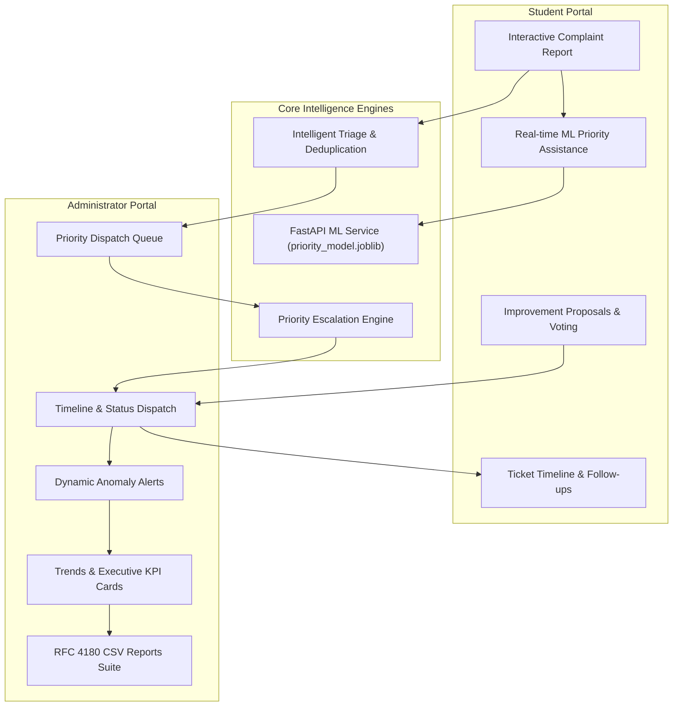

# FixLens AI — AI-Based Campus Maintenance Analysis & Improvement Management System

[](https://vercel.com)
[](https://render.com)
[](https://supabase.com)
[](ml/evaluation_results.json)
[](src/test/)

FixLens AI is a full-stack campus facilities and maintenance management platform. It combines student issue reporting, photographic evidence upload, intelligent duplicate complaint detection, dynamic maintenance anomaly analysis, smart campus improvement proposals, and real-time AI priority assistance powered by a trained **scikit-learn TF-IDF + Random Forest Classifier** served via **FastAPI**.

---

## 1. Problem Statement & Proposed Solution

### The Problem
Traditional campus maintenance management relies on paper registers, unstructured emails, or disjointed messaging groups. This leads to:
- **Severe Ticket Redundancy**: Multiple students reporting the same broken classroom AC or water leak.
- **Unclear Prioritization**: Urgent safety hazards (e.g., exposed sparking wires) buried under cosmetic issues.
- **Lack of Transparency**: Students receiving no progress updates on their reported tickets.
- **Neglected Hotspots**: Facilities teams lacking visibility into recurring systemic maintenance failures across buildings.

### The FixLens AI Solution
FixLens AI modernizes campus facilities operations through:
1. **Explainable AI Priority Classification**: An offline-resilient machine learning model evaluates complaint descriptions, category, student urgency, and affected count to assign `High`, `Medium`, or `Low` priority.
2. **Lexical & Spatial Duplicate Detection**: Identifies matching active complaints by building, room, and text similarity, linking reports to prevent ticket bloat.
3. **Multi-Factor Priority Escalation**: Elevates ticket priority when safety hazards, large student populations, or prolonged neglect are detected.
4. **Maintenance Anomaly Tracking**: Automatically detects category surges and building-wide recurring failures, creating dynamic alerts for administrators.
5. **Smart Notifications**: Real-time in-app notification center tracking status changes, escalations, and proposal updates.
6. **Campus Improvement Hub & RFC 4180 CSV Reports**: A student-powered proposal board with single-vote enforcement and an executive CSV export suite for campus planning meetings.

---

## 2. Technology Stack

- **Frontend Application**:
  - React 19 + TypeScript
  - TanStack Start + Nitro SSR (with Vercel Build Output API v3 support)
  - TanStack Router (file-based routing)
  - Tailwind CSS v4 + Radix UI + Lucide Icons + Sonner Toasts
  - Recharts (dynamic monthly trends, category pie charts, location bar charts)
  - Vitest + Testing Library (21 test suites, 210 frontend tests)
- **Machine Learning & Backend Service**:
  - Python 3.11 + FastAPI + Uvicorn
  - scikit-learn (TF-IDF Vectorizer + ColumnTransformer + 100-tree Random Forest Classifier)
  - pandas, numpy, joblib
- **Database, Auth & Cloud Storage**:
  - Supabase PostgreSQL 15+ (9 tables with complete Row-Level Security)
  - Supabase GoTrue Auth (student registration, email confirmation, admin roles)
  - Supabase Storage (private `complaint-images` bucket with security definer access control)

---

## 3. Core Functional Modules



### Module 1: Student Reporting & ML Assistance
- Step-by-step reporting with campus building and room selection.
- As-you-type AI priority prediction with confidence percentage and signal breakdown.
- Image attachment with instant preview and private storage upload.
- Duplicate detection warning with single-click follow-up linking.

### Module 2: Priority Queue & Administrative Dispatch
- Filterable complaint queue with search, category, status, and priority controls.
- Administrative timeline progression (`Submitted` &rarr; `Under Review` &rarr; `In Progress` &rarr; `Resolved` / `Rejected`).
- Resolution note publishing and admin priority override tracking.

### Module 3: Priority Escalation & Anomaly Detection (Phase 2)
- Multi-factor escalation rules checking safety triggers, affected student headcount, and overdue ticket age.
- Campus maintenance anomaly detection scanning for category spikes and recurring building breakdowns.
- Administrator alerts with persistent acknowledgment and resolution tracking.

### Module 4: Smart Notifications (Phase 3)
- In-app notification center bell with dynamic unread badges.
- Cross-session persistence in Supabase with `localStorage` fallback.
- Automated notification triggers for status changes, escalations, duplicate warnings, and proposal decisions.
- Background polling refresh every 30 seconds.

### Module 5: Dynamic Analytics & Smart Proposals (Phase 4)
- Live complaint KPI cards (Complaints Recorded, Resolution Rate %, Pending Backlog, High Priority Backlog).
- Dynamic monthly trend visualization (Reported vs. Resolved) derived directly from complaint timestamps.
- Smart Proposals board with single-vote enforcement per student and admin decision notification dispatch.

### Module 6: Production CSV Reports (Phase 4)
- Standardized RFC 4180 CSV generator with UTF-8 BOM encoding for Excel.
- Formula injection protection (CWE-1236) sanitizing `=`, `+`, `-`, `@`, `\t`, and `\r`.
- Supports filtered complaint exports, proposals exports, and multi-section executive summaries.

---

## 4. Local Installation & Quick Start

### Prerequisites
- Node.js 20+ and npm
- Python 3.10+ (Python 3.11 recommended)
- Git

### Step 1: Clone Repository
```bash
git clone https://github.com/mohamedfaahil/FixLens-AI.git
cd FixLens-AI/project-launchpad-main
```

### Step 2: Start the Python ML Service
In terminal 1:
```bash
# Install Python dependencies
pip install -r requirements.txt

# Run the FastAPI server (starts on http://127.0.0.1:8000)
python backend/main.py
```
Open interactive Swagger API docs at: [http://127.0.0.1:8000/docs](http://127.0.0.1:8000/docs)

### Step 3: Start the Frontend Application
In terminal 2:
```bash
# Install Node dependencies
npm install

# Start Vite development server
npm run dev
```
Open application at: [http://localhost:5173](http://localhost:5173)

---

## 5. Environment Variables Configuration

Copy `.env.example` to `.env` in the project root:

```ini
# Supabase Configuration (Public Client & Server Defaults)
VITE_SUPABASE_URL=https://snwcmuptrvmpniuevofj.supabase.co
VITE_SUPABASE_PUBLISHABLE_KEY=sb_publishable_CqxydmwI2c6JScSdFg5X4Q_HmwDzvk9
VITE_SUPABASE_PROJECT_ID=snwcmuptrvmpniuevofj

# Server-Side SSR Public Mirrors
SUPABASE_URL=https://snwcmuptrvmpniuevofj.supabase.co
SUPABASE_PUBLISHABLE_KEY=sb_publishable_CqxydmwI2c6JScSdFg5X4Q_HmwDzvk9
SUPABASE_PROJECT_ID=snwcmuptrvmpniuevofj

# FastAPI ML Service
# Local: http://127.0.0.1:8000
# Production: https://<your-service>.onrender.com
VITE_ML_API_URL=http://127.0.0.1:8000
```

---

## 6. Testing & Quality Assurance

FixLens AI includes comprehensive automated testing across both frontend and backend services:

### Run All Tests (Unified Command)
```bash
npm run test:all
```
Executes all 21 Vitest suites and 8 Python backend tests sequentially. If any test fails, the command exits with code 1.

### Run Frontend Tests
```bash
npm test
```

### Run Python ML Backend Tests
```bash
npm run test:backend
# Or: python backend/test_api.py
```

### Run Production Builds
```bash
# Standard TanStack Start build
npm run build

# Vercel-target production build (Nitro Build Output API v3)
$env:VERCEL="1"; npm run build  # Windows PowerShell
# VERCEL=1 npm run build        # Linux / macOS
```

---

## 7. Production Deployment Overview

- **Frontend**: Deployed on **Vercel** with automatic Build Output API v3 detection. See [docs/DEPLOYMENT.md](docs/DEPLOYMENT.md).
- **Backend**: Deployed on **Render** via Blueprint (`render.yaml`) running Python 3.11 with Uvicorn. See [docs/DEPLOYMENT.md](docs/DEPLOYMENT.md).
- **Database & Storage**: Hosted on **Supabase** with PostgreSQL 15, RLS security policies, and private photo storage. See [docs/DATABASE.md](docs/DATABASE.md).
- **Architecture & System Design**: See [docs/ARCHITECTURE.md](docs/ARCHITECTURE.md).

---

## 8. License & Capstone Attribution

Developed as an MCA Capstone Project by Mohamed Fahil.
Licensed under the [MIT License](LICENSE).
