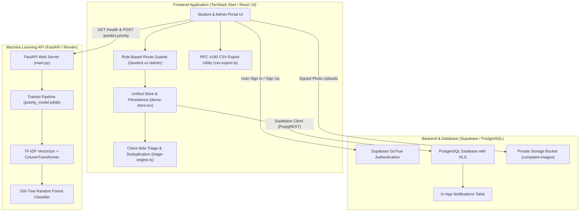
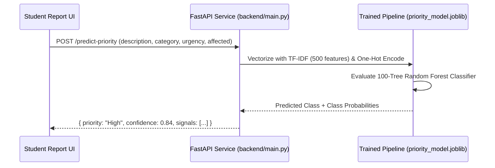

# FixLens AI — Technical Architecture & System Design

This document details the software architecture, data flow pipelines, machine learning models, and security boundaries of FixLens AI.

---

## 1. High-Level Architecture Diagram

---

## 2. Frontend Architecture (React 19 & TanStack Router)

### A. Routing & File-Based Layouts
The frontend uses **TanStack Start** with strict file-based routing:
- **Public Routes**:
  - `/`: Public campus landing page.
  - `/login`: Student login with email/password verification and resend confirmation.
  - `/register`: Student registration with department selection and profile creation.
  - `/admin-login`: Restricted facilities administrator login.
- **Student Portal (`/student/*`)**:
  - `student.index.tsx`: Student dashboard, active complaints summary, and recent notifications.
  - `student.report.tsx`: Interactive multi-step complaint report form with photo upload and live AI priority prediction.
  - `student.complaints.index.tsx` & `$id.tsx`: Personal complaint tracker, detailed timeline progression, and follow-up notes.
  - `student.improvements.tsx`: Campus improvement proposals board and community voting.
  - `student.profile.tsx`: Student account information.
- **Administrator Portal (`/admin/*`)**:
  - `admin.index.tsx`: High-level maintenance overview and quick stats.
  - `admin.queue.tsx`: Dispatch queue with AI-assisted priority sorting and filter controls.
  - `admin.complaints.index.tsx` & `$id.tsx`: Comprehensive complaint registry, timeline editor, resolution note publisher, and priority override.
  - `admin.improvements.tsx`: Campus proposal review, status approval, and planning notes.
  - `admin.analytics.tsx`: Dynamic trends, KPI executive cards, category/location distributions, and recurring issue hotspots.
  - `admin.reports.tsx`: Printable planning summary with CSV export suite.
  - `admin.model.tsx`: AI Model health inspector and live inference testing harness.

### B. Session & State Architecture (`demo-store.tsx`)
- Provides unified React state management across the application.
- Integrates live Supabase synchronization with automatic fallback to client-side `localStorage` when offline.
- Keeps separate student and administrator session states, eliminating cross-session data leaks.

---

## 3. Machine Learning Priority Prediction Pipeline

### Model Specifications
- **Framework**: `scikit-learn` 1.4+
- **Artifact**: `ml/priority_model.joblib` (~685 KB)
- **Feature Extraction**:
  - `description`: `TfidfVectorizer(max_features=500, stop_words='english', ngram_range=(1,2))`
  - `category` & `urgency`: `OneHotEncoder(handle_unknown='ignore')`
  - `affected`: `StandardScaler()`
- **Classifier**: `RandomForestClassifier(n_estimators=100, class_weight='balanced', random_state=42)`
- **Evaluation Accuracy**: **95.45%** on test holdout dataset (`ml/dataset.csv`).

### Explainable Signals
In addition to the predicted priority, the model generates human-interpretable rationale signals:
- Confidence percentage (e.g. `84.6% for High priority`).
- Class probability distribution (High / Medium / Low).
- Category and student urgency impact factors.

---

## 4. Intelligent Triage & Duplicate Complaint Detection

Implemented in `src/lib/triage-engine.ts`:
- **Collision Resistance**: Complaint IDs are generated via cryptographic pseudo-random strings: `CMP-YYYYMMDD-XXXXXX`.
- **Duplicate Matching Heuristic**:
  1. **Exact Location Match**: Building and room comparison.
  2. **Category Equivalence**: Same maintenance category.
  3. **Lexical Jaccard & Token Similarity**: Evaluates word overlap between complaint descriptions.
  4. **Time Proximity**: Matches tickets reported within the last 14 days.
- **Duplicate Action**: If a duplicate is identified, the student is notified via toast and prompt. If confirmed, the ticket is linked to the primary complaint (`linked_complaint_id`), preventing ticket fragmentation.

---

## 5. Priority Escalation & Anomaly Detection (Phase 2)

### Priority Escalation Engine
Evaluates complaints for dynamic priority elevation based on multi-factor risks:
1. **Critical Safety Keywords**: Matches terms like *"sparking"*, *"smoke"*, *"gas leak"*, *"fire hazard"*, *"flooding"*.
2. **Impact Scale**: Complaints affecting &ge; 50 students automatically elevate priority.
3. **Prolonged Neglect**: Tickets unaddressed for &gt; 5 days trigger overdue escalation.

### Campus Maintenance Anomaly Engine
Scans aggregate complaint velocity to detect systemic campus infrastructure failures:
- **Category Spikes**: Detects unusual surges in specific issue types within a 48-hour window.
- **Building Hotspots**: Flags campus facilities exhibiting repeated infrastructure breakdowns.
- **Dynamic Alerts**: Alerts are surfaced directly in the administrator overview and analytics dashboard with acknowledgment states.

---

## 6. Smart In-App Notifications (Phase 3)

- **Notifications Bell Popover**: Displays notification history, unread counters, and "Mark all as read" controls.
- **Trigger Events**:
  - Complaint status transitions (`Submitted` &rarr; `In Progress` &rarr; `Resolved`).
  - Priority escalations (e.g., ticket escalated from Medium to High).
  - Duplicate complaint alerts.
  - Campus improvement proposal decisions.
- **Storage Layer**: Persisted to Supabase `notifications` table with client `localStorage` caching and automated 30-second polling.

---

## 7. Dynamic Analytics & Production CSV Engine (Phase 4)

- **Dynamic Monthly Trends**: Computes historical complaint volume and resolution rates dynamically from complaint timestamps rather than static arrays.
- **Executive KPI Cards**: Real-time resolution rate %, pending backlog count, and critical high-priority ticket tracking.
- **RFC 4180 CSV Engine (`csv-export.ts`)**:
  - Double-quote cell escaping and CRLF row terminators.
  - Prepend UTF-8 Byte Order Mark (`\uFEFF`) for Excel character compatibility.
  - **Formula Injection Mitigation (CWE-1236)**: Sanitizes cells beginning with `=`, `+`, `-`, `@`, `\t`, or `\r`.
  - Supports filtered complaint exports, proposals exports, and executive planning summaries.
