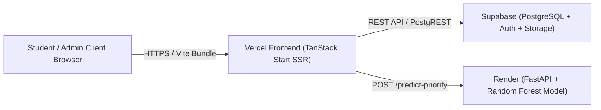

# FixLens AI — Production Deployment Guide

This guide details the deployment procedures for FixLens AI across **Vercel** (Frontend), **Render** (FastAPI Machine Learning Service), and **Supabase** (PostgreSQL Database, Auth, and Storage).

---

## 1. System Architecture Overview



---

## 2. Supabase Deployment (Database, Auth, Storage)

### Step 1: Create Supabase Project
1. Log in to [Supabase Console](https://supabase.com/dashboard) and create a new project.
2. Record your **Project URL** (`https://<project-ref>.supabase.co`) and **Publishable/Anon Key** from *Settings &rarr; API*.

### Step 2: Apply Database Schema & Policies
Open *Supabase Dashboard &rarr; SQL Editor &rarr; New Query* and execute the schema scripts in this order:
1. `supabase/schema.sql` (Creates all 9 tables, profiles trigger, and RLS policies).
2. `supabase/storage.sql` (Initializes private `complaint-images` bucket and access control function).
3. `supabase/migrations/20261102_phase2_escalation_anomalies.sql` (Applies Phase 2 escalation tables).

### Step 3: Configure Authentication
1. Go to *Authentication &rarr; Providers &rarr; Email*.
2. Enable Email provider.
3. Configure Site URL and Redirect URLs to your production Vercel domain:
   - Site URL: `https://<your-app>.vercel.app`
   - Redirect URL: `https://<your-app>.vercel.app/**`
4. Create the initial facilities administrator account or confirm admin email:
   - Email: `adminfix@gmail.com` (or your chosen facilities admin email).
   - In Supabase SQL Editor, verify or assign the administrator role:
     ```sql
     UPDATE public.profiles
     SET role = 'admin'
     WHERE email = 'adminfix@gmail.com';
     ```

---

## 3. Render Deployment (FastAPI Machine Learning Service)

The ML prediction service is a lightweight FastAPI web application serving the trained TF-IDF + Random Forest model pipeline (`ml/priority_model.joblib`).

### Deployment via Render Blueprint (`render.yaml`)
1. Log in to [Render Dashboard](https://dashboard.render.com).
2. Click **New +** &rarr; **Blueprint** and connect your GitHub repository (`FixLens-AI`).
3. Render reads `render.yaml` automatically:
   - **Service Name**: `fixlens-ml-api`
   - **Environment**: Python 3.11.9
   - **Build Command**: `pip install -r requirements.txt`
   - **Start Command**: `uvicorn backend.main:app --host 0.0.0.0 --port $PORT`
   - **Plan**: Free

### Render Environment Variables Configuration
Under *Render Dashboard &rarr; fixlens-ml-api &rarr; Environment*:

| Key | Production Value | Description |
| :--- | :--- | :--- |
| `PYTHON_VERSION` | `3.11.9` | Pinned Python runtime matching the serialized scikit-learn model |
| `ALLOWED_ORIGINS` | `https://mohamedfaahil-fixlens-ai.vercel.app` | Exact allowed production origin for the deployed Vercel frontend. **Required in production.** Unrestricted wildcards are strictly rejected. |
| `MODEL_PATH` | `ml/priority_model.joblib` | Path to trained Random Forest model artifact (default auto-detected) |

> [!IMPORTANT]
> `localhost` origins (such as `http://localhost:3000` or `http://localhost:5173`) belong exclusively in local development configuration and must **never** be included in Render's production `ALLOWED_ORIGINS`. In development mode, `backend/main.py` automatically permits local connections without requiring `ALLOWED_ORIGINS` to be configured.

### Cold-Start Performance Note
On Render's Free tier, the service automatically spins down after 15 minutes of inactivity.
- **Wakeup Latency**: Initial cold-start request takes ~40–50 seconds.
- **Frontend Mitigation**: The frontend (`src/lib/ml-api.ts`) fires an early background `/health` ping (`warmupMLService()`) as soon as a student opens the report page. If the API is still warming up, the frontend gracefully falls back to deterministic rule-based priority assessment without blocking complaint submission.

---

## 4. Vercel Deployment (Frontend Application)

FixLens AI utilizes **TanStack Start with Nitro SSR**.

### Build Output API Configuration
The project is preconfigured in `vite.config.ts` to detect Vercel's build environment:
```ts
const isVercel = Boolean(process.env.VERCEL || process.env.NITRO_PRESET === "vercel");
export default defineConfig({
  tanstackStart: { server: { entry: "server" } },
  ...(isVercel ? { nitro: { preset: "vercel" } } : {}),
});
```
When building in Vercel (`VERCEL="1"`), Nitro automatically targets the **Vercel Build Output API v3**, outputting `.vercel/output/static` and `.vercel/output/functions/__server.func`.

### Step 1: Import Project to Vercel
1. Log in to [Vercel Dashboard](https://vercel.com/dashboard).
2. Click **Add New...** &rarr; **Project** and select `mohamedfaahil/FixLens-AI`.
3. In **Build and Output Settings**:
   - **Framework Preset**: Other (or TanStack Start / Vite)
   - **Build Command**: `npm run build`
   - **Output Directory**: Automatically detected from `.vercel/output`

### Step 2: Configure Environment Variables
Under *Project Settings &rarr; Environment Variables*, add:

| Variable Name | Example / Production Value | Environment |
| :--- | :--- | :--- |
| `VITE_SUPABASE_URL` | `https://snwcmuptrvmpniuevofj.supabase.co` | Production, Preview, Dev |
| `VITE_SUPABASE_PUBLISHABLE_KEY` | `sb_publishable_...` | Production, Preview, Dev |
| `VITE_SUPABASE_PROJECT_ID` | `snwcmuptrvmpniuevofj` | Production, Preview, Dev |
| `VITE_ML_API_URL` | `https://fixlens-ml-api.onrender.com` | Production, Preview, Dev |
| `SUPABASE_URL` | `https://snwcmuptrvmpniuevofj.supabase.co` | Production, Preview, Dev |
| `SUPABASE_PUBLISHABLE_KEY` | `sb_publishable_...` | Production, Preview, Dev |

> [!CAUTION]
> Never configure `SUPABASE_SECRET_KEY` with a `VITE_` prefix. Client bundles must never contain service role secrets.

---

## 5. Post-Deployment Verification Checklist

Once deployed, execute the following verification steps:

- [ ] **Render API Health**: Open `https://<render-url>/health` in browser.
  - Expected response: `{"status": "healthy", "model_loaded": true, ...}`
- [ ] **Vercel Frontend Load**: Navigate to `https://<vercel-url>`. Home page and routes load cleanly.
- [ ] **Student Authentication**: Register a student account with campus email & verify confirmation flow.
- [ ] **AI Model Prediction**: Fill out complaint description in Student Report form. Verify AI priority card displays model confidence.
- [ ] **Complaint Persistence**: Submit complaint. Confirm row appears in Supabase `complaints` table.
- [ ] **Photo Storage**: Attach a photo to complaint. Verify file appears in private `complaint-images` bucket.
- [ ] **Admin Portal & Guard**: Sign in as administrator at `/admin-login`. Verify queue, analytics cards, and proposals board load live data.
- [ ] **CSV Exports**: Click "Export CSV" on `/admin/complaints` and verify downloaded file formatting.

---

## 6. Troubleshooting Common Issues

| Symptom | Root Cause | Resolution |
| :--- | :--- | :--- |
| **CORS error calling `/predict-priority`** | FastAPI origin mismatch | Add Vercel URL to `ALLOWED_ORIGINS` in Render environment variables. |
| **Vercel deployment says "No Output Directory"** | Nitro preset not set to Vercel | Verify `vite.config.ts` includes `const isVercel = Boolean(process.env.VERCEL...);`. |
| **403 Forbidden uploading photos** | RLS policy or storage bucket issue | Ensure `supabase/storage.sql` was run and bucket `complaint-images` exists. |
| **Admin Login redirects to student portal** | Profile role is not `'admin'` | Run `UPDATE profiles SET role = 'admin' WHERE email = '<admin-email>';` in Supabase SQL editor. |
| **Render ML API fails during build** | Missing packages | Confirm `requirements.txt` contains `scikit-learn`, `pandas`, `fastapi`, and `uvicorn`. |
